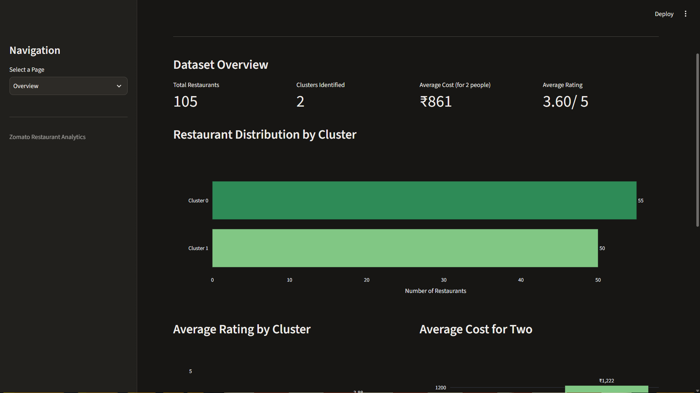
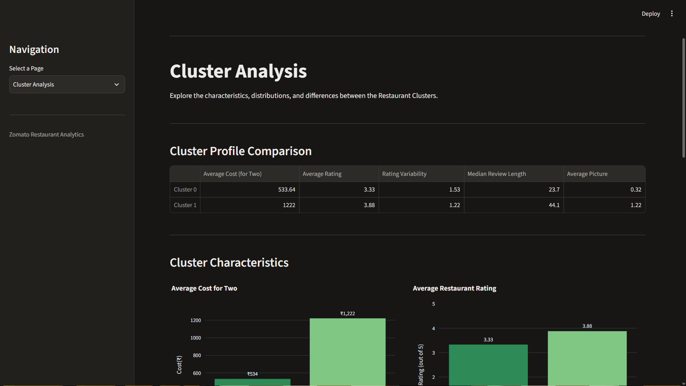
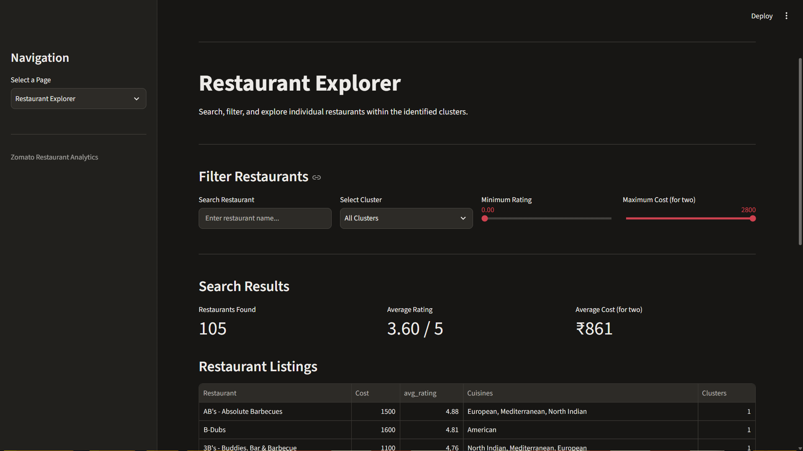
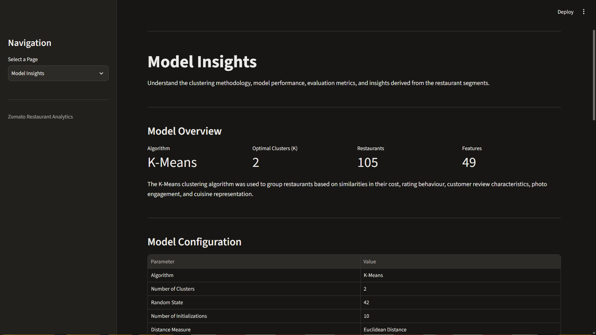

# 🍽️ Zomato Restaurant Clustering & Analytics

## 📌 Project Overview

### 🌐 Live Dashboard

**Explore the interactive restaurant clustering dashboard here:**

[Launch Zomato Restaurant Analytics](https://zomato-restaurant-clustering-ssjg7mgqttcfaznvxandz.streamlit.app/)

This project uses unsupervised machine learning to identify meaningful patterns among restaurants using their pricing, ratings, review characteristics, customer engagement, and cuisine information.

The objective is to group similar restaurants into clusters and understand how they differ in terms of affordability, customer ratings, review behavior, and engagement.

The project also includes an interactive **Streamlit dashboard** that allows users to explore restaurant clusters, compare characteristics, and investigate individual restaurants.

---

## 🎯 Objectives

- Perform exploratory data analysis on restaurant data.
- Clean and preprocess restaurant and review data.
- Engineer meaningful features from customer reviews.
- Apply unsupervised machine learning using K-Means clustering.
- Evaluate clustering performance using multiple metrics.
- Analyze and interpret restaurant clusters.
- Develop an interactive dashboard for exploring the results.

---

## 📊 Dataset

The project uses restaurant-level data along with customer review information.

- **Restaurants analyzed:** 105
- **Reviews sampled for analysis:** 10,000
- **Final features:** 49
- **Clusters identified:** 2

### Features used

| Feature | Description |
|---|---|
| Cost | Approximate cost for two people |
| Average Rating | Average customer rating |
| Rating Standard Deviation | Variability in customer ratings |
| Median Review Length | Median number of words in reviews |
| Average Photo Engagement | Average photo-related engagement |
| Cuisine Features | Binary encoded cuisine categories |

Restaurant collection information was excluded from the clustering process due to high cardinality and missing values.

---

## ⚙️ Methodology

### 1. Data Understanding & Exploratory Data Analysis

- Examined dataset structure and feature distributions.
- Identified missing values and inconsistencies.
- Analyzed restaurant costs, ratings, cuisines, and review characteristics.
- Explored patterns in customer reviews and restaurant engagement.

### 2. Data Preparation & Feature Engineering

- Cleaned and prepared restaurant-level data.
- Processed customer reviews.
- Extracted review-related behavioral features.
- Aggregated review information at the restaurant level.
- Encoded cuisine categories into binary features.
- Scaled numerical features.
- Prepared the final feature matrix for clustering.

### 3. Clustering

Applied **K-Means clustering** to group restaurants based on their characteristics.

| Parameter | Value |
|---|---|
| Algorithm | K-Means |
| Number of clusters (K) | 2 |
| Random State | 42 |
| Number of Initializations | 10 |
| Distance Metric | Euclidean Distance |
| Number of Features | 49 |

### 4. Model Evaluation

The clustering model was evaluated using multiple metrics to understand cluster compactness, separation, and overall structure.

| Metric | Value |
|---|---:|
| Inertia | 461.72 |
| Silhouette Score | 0.2073 |
| Davies-Bouldin Index | 1.7012 |
| Calinski-Harabasz Index | 34.0173 |

The evaluation indicates that the identified clusters have some structure but also exhibit overlap. The results should therefore be interpreted as exploratory groupings rather than sharply separated restaurant categories.

---

## 🔍 Cluster Analysis

The two clusters exhibit differences in restaurant pricing, ratings, customer review behavior, and engagement.

| Metric | Cluster 0 | Cluster 1 |
|---|---:|---:|
| Number of Restaurants | 55 | 50 |
| Average Cost for Two (₹) | 533.64 | 1,222.00 |
| Average Rating | 3.33 | 3.88 |
| Rating Variability | 1.53 | 1.22 |
| Median Review Length (Words) | 23.7 | 44.1 |
| Average Photo Engagement | 0.32 | 1.22 |

### Cluster 0 — More Affordable Restaurants

- Lower average cost.
- Lower average customer ratings.
- Higher variability in customer ratings.
- Shorter customer reviews.
- Lower photo engagement.

### Cluster 1 — Higher-Priced Restaurants

- Higher average cost.
- Higher average customer ratings.
- Lower rating variability.
- Longer customer reviews.
- Higher photo engagement.

These labels are descriptive interpretations of the observed patterns and do not imply that every restaurant in a cluster shares the same characteristics.

---

## 📈 Visualizations

The project includes visual analysis of:

- Restaurant cost distributions.
- Rating distributions.
- Cluster comparisons.
- Feature patterns.
- Cluster profiles.
- Restaurant-level comparisons.

---

## 🖥️ Interactive Dashboard

The project includes a Streamlit dashboard with four sections:

### Overview
Provides a high-level summary of the restaurant clusters, including key metrics, cluster distribution, and comparative visualizations.

### Cluster Analysis
Explores cluster profiles and compares the clusters across important numerical and behavioral features.

### Restaurant Explorer
Allows users to search and filter restaurants based on restaurant name, cluster, rating, and cost.

### Model Insights
Displays model configuration, evaluation metrics, cluster distribution, key findings, and limitations.

### Dashboard Preview

#### Overview


#### Cluster Analysis


#### Restaurant Explorer


#### Model Insights


---

## 🛠️ Tech Stack

- **Python**
- **Pandas** — Data manipulation and analysis
- **NumPy** — Numerical computing
- **Scikit-learn** — Feature preprocessing and K-Means clustering
- **Matplotlib & Seaborn** — Data visualization
- **Plotly** — Interactive visualizations
- **Streamlit** — Interactive dashboard
- **NLTK** — Text preprocessing
- **WordCloud** — Text visualization

---

## 📁 Project Structure

```text
zomato-clustering-model/
│
├── 1. data/
│   ├── raw/
│   └── processed/
│
├── 2. notebooks/
│   ├── 01_data_understanding.ipynb
│   ├── 02_data_preparation_and_feature_engineering.ipynb
│   ├── 03_preprocessing_and_clustering_preparation.ipynb
│   ├── 04_clustering_and_model_evaluation.ipynb
│   ├── 05_cluster_analysis_and_restaurant_profiling.ipynb
│   ├── 06_visualization_and_insights.ipynb
│   └── 07_final_results_and_export.ipynb
│
├── 3. src/
│
├── 4. models/
│
├── 5. visualizations/
│
├── 6. app/
│   └── streamlit_app.py
│
├── requirements.txt
├── .gitignore
└── README.md
```

---

## 🚀 Installation & Setup

### 1. Clone the Repository

```bash
git clone <your-repository-url>
cd zomato-clustering-model
```

### 2. Create a Virtual Environment

```bash
python -m venv .venv
```

### 3. Activate the Virtual Environment

**Windows:**

```bash
.venv\Scripts\activate
```

**macOS/Linux:**

```bash
source .venv/bin/activate
```

### 4. Install Dependencies

```bash
pip install -r requirements.txt
```

### 5. Run the Dashboard

```bash
python -m streamlit run "6. app/streamlit_app.py"
```

The dashboard will open automatically in your browser.

---

## ⚠️ Limitations

- The analysis is based on a sample of restaurants rather than the entire restaurant population.
- The clustering results depend on the selected features and preprocessing decisions.
- K-Means assumes cluster structures that may not fully reflect real-world restaurant similarities.
- The relatively low Silhouette Score indicates overlap between the identified clusters.
- Cluster assignments should not be interpreted as definitive rankings of restaurant quality.
- Review-based features may be influenced by the quantity and characteristics of available reviews.

---

## 🔮 Future Improvements

- Explore alternative clustering algorithms such as DBSCAN and hierarchical clustering.
- Experiment with different numbers of clusters.
- Improve feature selection and feature weighting.
- Incorporate additional restaurant characteristics.
- Explore more advanced review sentiment analysis.
- Improve cluster validation and stability analysis.
- Deploy the dashboard for public access.

---

## 👨‍💻 Author

**Adil Ali**

Data Science | Machine Learning | Data Analytics